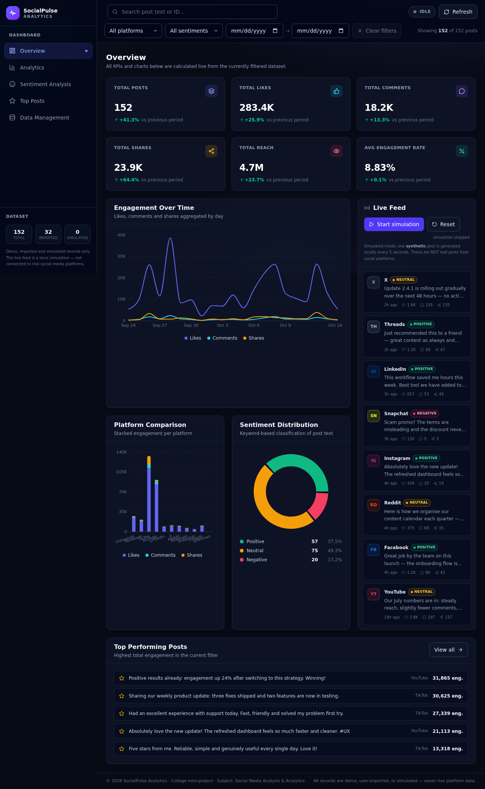

# SocialPulse Analytics

**Real-Time Social Media Analytics Dashboard** — a college mini-project for the subject *Social Media Analysis & Analytics*.



---

## 1. Objective

Build a fully working analytics dashboard that demonstrates the complete social-media analytics pipeline — data ingestion, cleaning, KPI computation, visualization, sentiment analysis, filtering and reporting — **without any paid APIs, servers, databases or logins**. Everything runs locally in the browser using demo data and CSV uploads.

> **Important:** all data in this project is **demo, user-imported, or simulated**. The "live" feed is a local simulation that generates synthetic posts every 5 seconds. It is **not** connected to Instagram, Facebook, X, YouTube or LinkedIn.

## 2. Technologies

| Layer | Technology |
|---|---|
| UI framework | React 19 + Vite 8 (JavaScript) |
| Styling | Tailwind CSS 4 (`@tailwindcss/vite`) |
| Charts | Recharts 3 |
| CSV parsing/export | Papa Parse 5 |
| Icons | lucide-react |
| Persistence | Browser `localStorage` |
| Testing | Node test script (logic) + Playwright headless Chromium (E2E) |

No other runtime dependencies are used.

## 3. Quick start

```bash
npm install       # install dependencies
npm run dev       # start dev server → http://localhost:5173
```

Production build & preview:

```bash
npm run build     # production bundle in dist/
npm run preview   # serve the production build
```

Optional test suites (used during development to verify the acceptance criteria):

```bash
npm run verify    # 39 unit checks for sentiment / analytics / CSV logic (no browser needed)
npm run test:e2e  # 38 browser checks (needs: npx playwright install chromium)
```

Requirements: **Node.js 18+** (tested on Node 20).

## 4. Feature overview

| Page | What it demonstrates |
|---|---|
| **Overview** | 6 calculated KPI cards with previous-period comparison, engagement trend chart, platform comparison, sentiment donut, simulated live feed, top-posts preview |
| **Analytics** | All 5 required charts: Engagement Over Time (line), Platform Comparison (stacked bars), Sentiment Distribution (donut), Posting Activity (bars), Engagement Breakdown (horizontal bars) |
| **Sentiment Analysis** | Keyword classifier methodology + disclaimer, positive/negative lexicons, totals, percentages, sentiment trend over time, per-post classification reasons (`+3 / −1` matches) |
| **Top Posts** | Sortable (rate / engagement / likes / reach / date …), searchable, paginated table (top 10 + Load more) |
| **Data Management** | Drag-and-drop CSV import with validation & preview, replace/append modes, filtered CSV export, sample template download, reset/clear actions, storage info |

**Clickable KPI cards (Overview):** every card is a full-card, keyboard-accessible
navigation control that reuses the existing state router — Total Posts opens
Data Management; Total Likes / Comments / Shares / Avg Engagement Rate open the
Analytics *Engagement analytics* section (with the chosen metric highlighted and
the others dimmed); Total Reach opens the *Reach & audience* section (reach over
time + reach by platform). The target section smooth-scrolls into view with a
transient highlight ring and focus chip. Filters are global, so they survive
every navigation untouched.

Cross-cutting features:

- **Global filters** (platform, date range, sentiment, text search) live in one shared context → every KPI, chart, table, stat and export uses exactly the same filtered dataset. Clear Filters button with active-filter counter.
- **Simulated real-time feed** with Start / Pause / Resume / Reset, a live indicator, 5-second ticks, proper interval cleanup and a 600-record cap.
- **Persistence**: dataset, filters and simulation preference survive refresh via `localStorage`; corrupted storage falls back to demo data.
- **Responsive**: collapsible sidebar drawer + stacked layout on mobile/tablet.
- **Empty / loading / error states** everywhere (no crashes on empty data).

## 5. Methodology & formulas

All calculations live in `src/utils/analytics.js` and are pure functions (same input → same output). Nothing is hardcoded.

```
Total Engagement  = likes + comments + shares
Engagement Rate   = (likes + comments + shares) / reach × 100        (null when reach = 0)
Avg Engagement    = arithmetic mean of per-post rates, EXCLUDING reach = 0 posts
Total Reach       = Σ reach across posts  →  CUMULATIVE reach, not unique audience
```

- Division by zero is guarded: posts with `reach = 0` show `—` in the table and are excluded from the average (but their engagement still counts in totals).
- **Previous-period comparison:** with an active date filter, current range vs the immediately preceding window of equal length. Without a date filter, the dataset's own span is split in half (recent half vs earlier half). Deltas are shown only when both windows contain data, otherwise the card shows "No prior data". Zero baselines never produce `Infinity`.

### Sentiment classifier (`src/utils/sentiment.js`)

1. Lower-case the text and replace all non-alphanumeric characters with spaces.
2. Count configured **positive** and **negative** words/phrases as **whole tokens** (`best` ≠ `bestowed`, `hate` ≠ `Hathaway`).
3. `positive > negative → Positive`, `negative > positive → Negative`, otherwise `Neutral` (ties are neutral).

This is a **deterministic keyword-based estimate, not an AI/LLM** — the UI states this clearly. It cannot understand sarcasm, context or emoji.

### Period aggregation

`aggregateByDay()` groups posts into local calendar days (`YYYY-MM-DD`) for the time-series and activity charts; `aggregateByPlatform()` zero-fills all five platforms; `sentimentBreakdown()` returns counts + percentages that always sum to 100.

## 6. CSV import & export

### Flexible, alias-aware schema

Uploaded files do **not** need exact column names. Headers are normalised
(BOM-stripped, lower-cased, spaces/underscores/hyphens removed) and matched
against a maintainable alias dictionary in `src/utils/csv.js` (`COLUMN_ALIASES`):

| Field | Example accepted headers |
|---|---|
| post_id | `id`, `postid`, `tweet_id`, `post_identifier` |
| timestamp | `date`, `datetime`, `created_at`, `published date`, `time` |
| platform | `source`, `network`, `social_network`, `channel` |
| text | `content`, `message`, `caption`, `description`, `tweet`, `body` |
| likes | `like_count`, `total_likes`, `favorite_count`, `favourites` |
| comments | `comment_count`, `replies`, `reply_count` |
| shares | `share_count`, `reposts`, `retweets` |
| reach | `impressions`, `views`, `view_count`, `audience_reach` |

Platform values are normalised case/space/punctuation-insensitively across 10
supported networks (Instagram, Facebook, TikTok, YouTube, LinkedIn, X — with
`twitter`/`Twitter.com` → `X` — Reddit, Pinterest, Snapchat, Threads), including
domain forms (`TikTok.com`) and spaced forms (`Tik Tok`). Only genuinely unknown
values fall back to `Unknown` with a per-row warning; filters, charts, icons and
imported records all share the same canonical values.

Columns may appear in any order/capitalisation; extra columns are preserved as
per-record metadata. Comma, semicolon and tab delimiters are auto-detected;
quoted fields with commas, escaped quotes and newlines are handled by Papa Parse.

### Import preview + manual column mapping

After parsing, the Data Management page shows the **detected mapping as eight
dropdowns** (Post ID, Timestamp, Platform, Text, Likes, Comments, Shares, Reach)
plus a **preview of the first five mapped records**. Every dropdown change
re-validates instantly. Ambiguous auto-matches (e.g. both `date` and
`created_at`) are called out so the user can pick the right one. The dataset is
never modified until **Import records** is confirmed (**Cancel import** discards).

### Defaults for missing fields (always reported, never silent)

| Missing column | Default | Reporting |
|---|---|---|
| `text` | import blocked (actionable error: map a column or use the template) — unless `post_id` + one other field exist | error banner |
| `timestamp` | current date/time | warning chip + per-row warnings |
| `platform` | `Unknown` (own filter/chart entry) | warning chip + per-row warnings |
| `post_id` | generated unique `IMP-…` id | "N IDs generated" chip |
| `likes / comments / shares / reach` | `0` | "Defaults: …" chip listing every field — clearly *not* a measured value |

Row-level problems (invalid date, negative/non-numeric metric, empty text,
duplicate `post_id` on append) are skipped with numbered messages; valid rows
still import. Replace mode asks for confirmation; append dedupes by `post_id`.
Files > 10 MB are refused with a size hint; > 1 MB shows a "may take a moment"
notice.

### Export — two independent buttons

- **Export filtered data** → only the records matching the current filters
  (`exportFilteredData()`), feedback: "Filtered CSV exported successfully."
- **Download sample CSV template (25 records)** → always the same canonical
  25-record file (`post_id,timestamp,platform,text,likes,comments,shares,reach`),
  generated locally from a fixed seed **and fixed base timestamp** (byte-identical
  on every download, matching `public/socialpulse-sample-template.csv`), spanning
  Instagram, Facebook, TikTok, YouTube, LinkedIn, X and Reddit — works with an
  empty dataset, zero-result filters or a paused simulator
  (`downloadSampleTemplate()`), feedback: "Sample CSV downloaded successfully."
  Failures of either action show "Unable to download CSV. Please try again."
  instead of raw errors. Includes a UTF-8 BOM for Excel; cleanup of the object
  URL is delayed so the download is never cancelled.

A copy of the template also ships at [`public/socialpulse-sample-template.csv`](public/socialpulse-sample-template.csv).

## 7. Data persistence

| Key | Contents |
|---|---|
| `socialpulse.posts.v1` | active dataset (capped at **600 records** — the simulated feed cannot grow forever) |
| `socialpulse.filters.v1` | active filter selections |
| `socialpulse.simulation.v1` | simulation start/pause preference |

Every read/write is wrapped in try/catch: quota errors and corrupted JSON degrade gracefully back to the demo dataset instead of crashing.

**Cross-tab synchronisation:** a `storage`-event listener re-syncs the active
dataset and filters in every *other* open tab/window the moment one tab writes
(the event never fires in the writing tab, so it cannot loop). An Overview left
open in a second tab therefore updates immediately after an import elsewhere —
no manual refresh needed.

## 8. Architecture (how to explain it to faculty)

```
┌────────────────────────────────────────────────────────────────────┐
│  DashboardContext  (single source of truth)                        │
│   posts[]  +  filters{}  →  useMemo  →  filteredPosts / kpis /     │
│   comparison  +  datasetStats   (all derived, never stored)        │
└──────────┬──────────────────────────────┬──────────────────────────┘
           │                              │
   actions (import, export,       useSimulation() → one synthetic
   reset, clear, refresh)         post every 5s while "running"
           │                              │
┌──────────▼──────────────────────────────▼──────────────────────────┐
│  Pages: Overview · Analytics · Sentiment · Top Posts · Data Mgmt   │
│   ├─ KpiGrid        (components/kpi)                              │
│   ├─ Charts         (charts/* — Recharts, receive derived data)   │
│   ├─ LiveFeed       (components/feed)                             │
│   ├─ PostTable      (components/table)                            │
│   └─ CsvUploader    (components/csv → utils/csv.js → Papa Parse)  │
└────────────────────────────────────────────────────────────────────┘

utils/ (pure, unit-tested): analytics.js · sentiment.js · csv.js · format.js · storage.js
data/  samplePosts.js — seeded PRNG demo dataset (120 posts, 21 days, 5 platforms)
```

**Key principles a student can defend:**

1. **One source of truth** — the context holds the raw dataset + filters; *everything else is derived* with `useMemo`. No component stores its own copy of KPIs, so all views can never disagree.
2. **Pure logic, dumb UI** — all formulas/classification/validation live in `utils/` as framework-free functions → trivially unit-testable (`npm run verify`).
3. **Deterministic demo data** — `mulberry32(seed)` PRNG means "Reset to demo" reproduces the same dataset every time (easy to demo in viva). Simulated posts use `Math.random` and are flagged `source: 'simulation'`.
4. **Defensive data flow** — every boundary (localStorage, CSV file, simulation tick) validates its input; bad records are reported and skipped, never thrown at the UI.
5. **Component reuse** — `Card`, `EmptyState`, `ConfirmDialog`, `SentimentBadge`, `PlatformIcon`, `ChartTooltip`, `ChartLegend` keep markup lean and the design consistent.

### Data flow of one user action (example: importing a CSV)

`CsvUploader` → `parseCsvInput()` (Papa) → `checkRequiredColumns()` → `validateCsvRows()` → preview + errors → user picks Replace/Append → `context.importRecords()` (dedupe, sort, cap at 600) → `useEffect` persists to localStorage → `filteredPosts`, KPIs, charts, tables and exports all recompute automatically via memoised selectors.

## 9. Testing performed

| Suite | Command | Result |
|---|---|---|
| Logic tests (sentiment, KPIs, filters, aggregation incl. per-day/per-platform reach, alias mapping, platform normalisation incl. TikTok/Reddit/domains, defaults, CSV validation/round-trip, byte-stable canonical template) | `npm run verify` | **56/56 passed** |
| Browser E2E (load, 5 pages, filters combined, simulator, synonym/sparse/manual-mapping imports, 30-row TikTok/Reddit regression import, KPI cards = 150 right after append without refresh, cross-tab import sync, clickable KPI-card navigation with focus chips + filter preservation + keyboard Enter, template re-upload round-trip, replace confirmation, independent downloads incl. empty dataset, download feedback messages, persistence across reload, reset, empty states, zero-reach, mobile drawer, **0 console errors**) | `npm run test:e2e` | **92/92 passed** |
| Production build | `npm run build` | ✅ no errors |
| Visual review | screenshots in [`screenshots/`](screenshots/) incl. `csv-mapping-*.png` | desktop + mobile + importer UI verified |

## 10. Limitations

- **Sentiment** is keyword-based: sarcasm, slang, emoji and non-English text are misread by design (it is a transparent baseline, not an LLM).
- **Reach is cumulative**, not unique audience — overlapping audiences are double-counted (labelled in the UI).
- **No real platform APIs** — data comes from the demo generator, CSV imports, or the synthetic simulator.
- The **comparison window** (when no date filter is set) uses halves of the available data, so displayed totals (whole dataset) and the delta (half vs half) answer slightly different questions — the tooltip explains which.
- `localStorage` is per-browser/per-device (≈5 MB quota); the 600-record cap keeps usage ~100 KB.
- Single-user, client-side only — no auth, no backend, no multi-device sync.

## 11. Future improvements

1. Optional real data source (Meta/X APIs or a scraping backend) behind the same `posts[]` model.
2. Move sentiment to a lightweight ML model (or VADER) while keeping the keyword classifier as a baseline for comparison.
3. Unique-reach estimation via follower-count de-duplication.
4. PDF/Excel report export, date presets (7/30/90 days), per-platform dashboards.
5. Web Workers for parsing multi-MB CSVs and virtualised tables for 100k+ rows.
6. Unit tests with Vitest + React Testing Library for components.

## 12. Project structure

```
socialpulse/
├── index.html
├── vite.config.js
├── public/
│   └── socialpulse-sample-template.csv     # 25-row CSV template
├── scripts/
│   ├── verify.mjs                          # npm run verify  (39 logic checks)
│   └── e2e.mjs                             # npm run test:e2e (38 browser checks)
├── screenshots/                            # captured UI screenshots
└── src/
    ├── main.jsx
    ├── App.jsx                             # shell + state-based page router
    ├── index.css                           # Tailwind + design tokens
    ├── context/DashboardContext.jsx        # ★ single source of truth
    ├── hooks/useSimulation.js              # 5s synthetic-post interval
    ├── data/samplePosts.js                 # seeded demo dataset + simulator posts
    ├── utils/                              # pure logic (unit-tested)
    │   ├── analytics.js  sentiment.js  csv.js  format.js  storage.js  constants.js
    ├── charts/                             # Recharts visualisations + shared tooltip/legend
    ├── components/
    │   ├── Sidebar.jsx  Header.jsx  Logo.jsx
    │   ├── common/   (Card, EmptyState, ConfirmDialog, badges, …)
    │   ├── kpi/  feed/  table/  csv/
    └── pages/                              # Overview, Analytics, Sentiment, Top, Data
```

---

© 2026 SocialPulse Analytics · College mini-project · Subject: Social Media Analysis & Analytics
